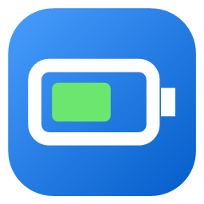
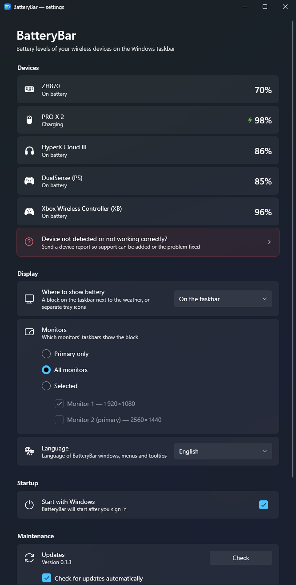
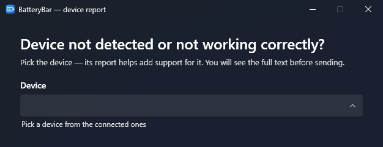

  

<h1 align="center">BatteryBar</h1>

  Battery levels of your wireless mouse, keyboard, headset and gamepads — right on the Windows 11 taskbar.

  <a href="README.md"> Русский</a>
  &nbsp;·&nbsp;
   <b>English</b>

  

## Features

- **On the taskbar, next to the weather.** A compact block with an icon and percentage for every device. Works with the taskbar at the bottom or on the side, on one or all monitors.
- **Or in the tray.** Each device can get its own tray icon with the charge level — or use both at once.
- **Charging and low battery at a glance.** A green bolt while charging; the percentage turns red at 20% and below.
- **Devices come and go automatically.** A device appears when it is turned on and disappears when it is turned off. A sleeping mouse keeps its last known level instead of blinking.
- **Several gamepads.** Gamepads are labelled PS / PS4 / XB, with a number if you have two of the same kind.
- **Windows 11 look.** Settings window and tray menu in the native Fluent style, light or dark — follows your Windows theme.
- **English and Russian.** Picks your system language by default.
- **Starts with Windows**, if you want it to.
- **One-click updates.** A red dot on the tray icon tells you a new version is out; install it right from Settings.

## Tray icons

Instead of the taskbar block (or together with it), every device can get its own tray icon: the device glyph and a battery bar. The bar is green while charging and red when low; the exact percentage is in the tooltip.

  

## Settings window

  

## Supported devices

| Devices | Status |
|---|---|
| Logitech mice and keyboards (Lightspeed, Unifying, Bolt receivers and cable) | ✅ tested with PRO X Superlight 2 |
| HyperX Cloud III Wireless | ✅ tested |
| Xbox controllers (adapter, Bluetooth, USB) | ✅ tested |
| DualSense / DualSense Edge (USB, Bluetooth) | ✅ tested |
| AirPods and Beats | ✅ tested with AirPods Pro 2 |
| Zornher ZH870 keyboard | ✅ tested |
| DualShock 4 | 🧪 should work |
| Razer wireless mice, keyboards and headsets | 🧪 should work |
| SteelSeries Arctis Nova 7 / 7P / 7X, Nova 5, Nova Pro Wireless, Arctis 7 / 7+ / 1 / 9 / Pro | 🧪 should work |
| HyperX Cloud Alpha Wireless, Cloud II Wireless, Cloud Flight | 🧪 should work |
| Corsair Void and related headsets | 🧪 should work |
| Logitech G headsets (G535, G733, PRO X and others) | 🧪 should work |
| Any Bluetooth device whose battery Windows shows in Settings | 🧪 should work |

🧪 — implemented from public protocol descriptions but not yet confirmed on real hardware. If it works (or doesn't) for you, please let us know.

### Your device isn't detected?

Open **Settings → Device not detected?**, pick the device and press **Send to GitHub**. A pre-filled issue opens in your browser — you see the whole report before sending. It contains only technical device IDs: no serial numbers and no personal names.

  

## Installation

Download the latest version from [Releases](../../releases/latest) — pick one:

- **`BatteryBar-…-Setup.exe` — installer.** Installs for the current user (no admin rights needed), adds a Start menu shortcut and, optionally, starts with Windows. Uninstall it as usual in **Settings → Apps**.
- **`BatteryBar-…-Portable.zip` — portable.** Unpack anywhere, even to a USB stick, and run `BatteryBar.exe`. Settings are kept next to the program in the `data` folder.

Both need the [.NET 9 Desktop Runtime](https://dotnet.microsoft.com/download/dotnet/9.0) (free, from Microsoft). If it is missing, the installer offers to open the download page, and the portable version asks for it on first launch.

Click the BatteryBar tray icon to open the settings.

**Requirements:** Windows 11. On Windows 10 the tray icons should work, but the taskbar block is not supported yet.

### Tray icons are hidden?

Windows 11 hides new tray icons under the ^ arrow. To keep them visible, open **Windows Settings → Personalization → Taskbar → Other system tray icons** and turn on the ones you need, or simply drag an icon from under the arrow onto the taskbar.

## Privacy

BatteryBar works on your computer: no accounts, no telemetry. It only reads battery information from your devices and sends them nothing but read-only battery queries — and only to devices it recognises exactly.

It goes online in two cases:
- **update check** — after start and every 12 hours it asks GitHub for the latest version number. Nothing about you or your devices is sent. Automatic checks can be turned off in Settings;
- when you press **Send to GitHub** or **Suggest an improvement** yourself — a page opens in your browser.

## For developers

Building from source, project structure and how to add support for a new device: [docs/DEVELOPMENT.md](docs/DEVELOPMENT.md).

Device protocols are based on the public descriptions from [HeadsetControl](https://github.com/Sapd/HeadsetControl), [HyperHeadset](https://github.com/LennardKittner/HyperHeadset), [OpenRazer](https://github.com/openrazer/openrazer), [OpenPods](https://github.com/adolfintel/OpenPods) and [Solaar](https://github.com/pwr-Solaar/Solaar); the code is written from scratch.
