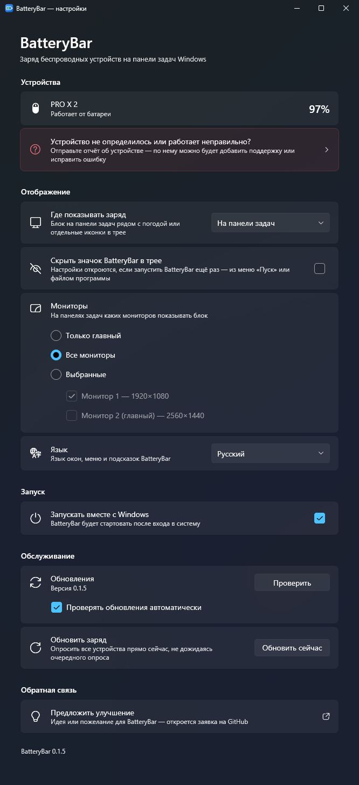
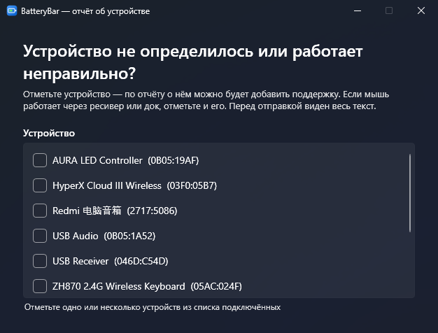

  

<h1 align="center">BatteryBar</h1>

  Заряд беспроводной мыши, клавиатуры, гарнитуры и геймпадов — прямо на панели задач Windows 11.

   <b>Русский</b>
  &nbsp;·&nbsp;
  <a href="README.en.md"> English</a>

  

## Возможности

- **На панели задач, рядом с погодой.** Компактный блок со значком и процентом для каждого устройства. Работает с панелью снизу или сбоку, на одном или на всех мониторах.
- **Или в трее.** У каждого устройства может быть своя иконка с зарядом — или и то, и другое сразу.
- **Зарядка и низкий заряд видны сразу.** Зелёная молния во время зарядки, процент становится красным при 20% и ниже.
- **Устройства появляются и исчезают сами.** Устройство показывается, когда его включают, и пропадает, когда выключают. Уснувшая мышь не мигает, а показывает последний известный заряд.
- **Несколько геймпадов.** У геймпадов подписи PS / PS4 / XB, а у двух одинаковых — ещё и номер.
- **В стиле Windows 11.** Окно настроек и меню трея в родном стиле Fluent, светлые или тёмные — как тема Windows.
- **Русский и английский.** По умолчанию — язык системы.
- **Запуск вместе с Windows**, если нужно.

## Окно настроек

  

## Поддерживаемые устройства

| Устройства | Статус |
|---|---|
| Мыши и клавиатуры Logitech (ресиверы Lightspeed, Unifying, Bolt и провод) | ✅ проверено на PRO X Superlight 2 |
| HyperX Cloud III Wireless | ✅ проверено |
| Геймпады Xbox (адаптер, Bluetooth, USB) | ✅ проверено |
| DualSense / DualSense Edge (USB, Bluetooth) | ✅ проверено |
| AirPods и Beats | ✅ проверено на AirPods Pro 2 |
| Клавиатура Zornher ZH870 | ✅ проверено |
| DualShock 4 | 🧪 должно работать |
| Беспроводные мыши, клавиатуры и гарнитуры Razer | 🧪 должно работать |
| SteelSeries Arctis Nova 7 / 7P / 7X, Nova 5, Nova Pro Wireless, Arctis 7 / 7+ / 1 / 9 / Pro | 🧪 должно работать |
| HyperX Cloud Alpha Wireless, Cloud II Wireless, Cloud Flight | 🧪 должно работать |
| Гарнитуры Corsair Void и родственные | 🧪 должно работать |
| Гарнитуры Logitech G (G535, G733, PRO X и другие) | 🧪 должно работать |
| Любые Bluetooth-устройства, заряд которых Windows показывает в Параметрах | 🧪 должно работать |

🧪 — сделано по открытым описаниям протоколов, но на настоящем устройстве ещё не подтверждено. Если у вас работает (или не работает) — сообщите, пожалуйста.

### Устройство не определилось?

Откройте **Настройки → «Устройство не определилось?»**, выберите устройство и нажмите **«Отправить на GitHub»**. В браузере откроется заполненная заявка — весь отчёт виден до отправки. В нём только технические идентификаторы устройств: без серийных номеров и личных имён.

  

## Установка

1. Скачайте последнюю версию из [Releases](../../releases/latest) и распакуйте в любую папку, например `%LOCALAPPDATA%\Programs\BatteryBar`.
2. Установите [.NET 9 Desktop Runtime](https://dotnet.microsoft.com/download/dotnet/9.0), если его ещё нет (Windows сама предложит это при первом запуске).
3. Запустите `BatteryBar.exe`. Клик по его иконке в трее открывает настройки; там же включается **«Запускать вместе с Windows»**.

**Требования:** Windows 11. На Windows 10 должны работать иконки в трее, а блок на панели задач пока не поддерживается.

### Иконки в трее спрятаны?

Windows 11 прячет новые иконки под стрелку ^. Чтобы они были видны всегда, откройте **Параметры Windows → Персонализация → Панель задач → Другие значки в трее** и включите нужные — или просто перетащите иконку из-под стрелки на панель.

## Приватность

BatteryBar работает только на вашем компьютере: без аккаунтов, телеметрии и доступа в интернет. Он лишь читает заряд устройств и отправляет им только запросы чтения заряда — и только тем, которые точно опознал. В интернет программа обращается, только когда вы сами нажимаете **«Отправить на GitHub»**.

## Для разработчиков

Сборка из исходников, устройство проекта и как добавить поддержку нового устройства: [docs/DEVELOPMENT.md](docs/DEVELOPMENT.md).

Протоколы устройств основаны на открытых описаниях из [HeadsetControl](https://github.com/Sapd/HeadsetControl), [HyperHeadset](https://github.com/LennardKittner/HyperHeadset), [OpenRazer](https://github.com/openrazer/openrazer), [OpenPods](https://github.com/adolfintel/OpenPods) и [Solaar](https://github.com/pwr-Solaar/Solaar); код написан с нуля.
